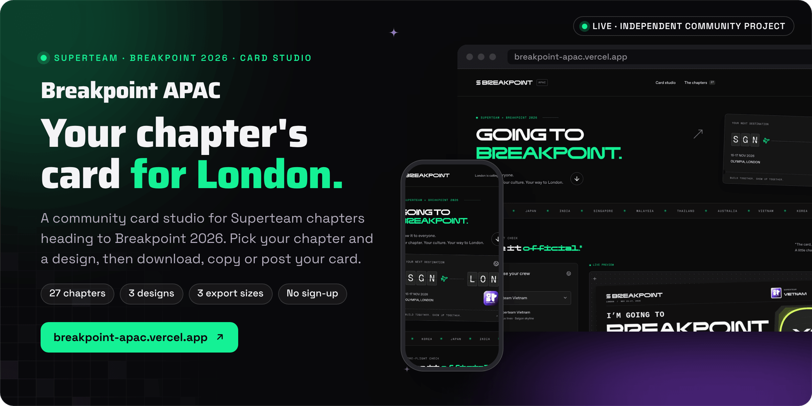
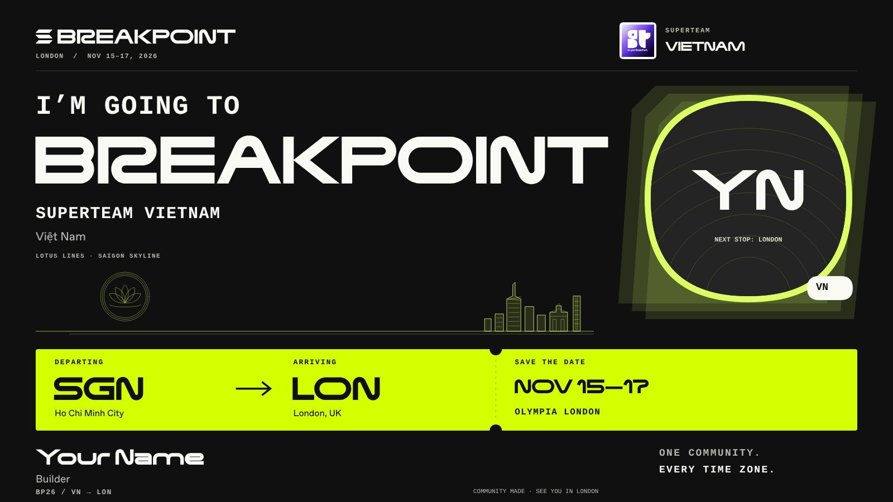

<div align="center">



<br><br>

<a href="https://breakpoint-apac.vercel.app"></a>&nbsp;&nbsp;
<a href="https://solana.com/breakpoint"></a>&nbsp;&nbsp;
<a href="https://superteam.fun/"></a>

<br><br>

<a href="https://breakpoint-apac.vercel.app"></a>


<h3>Your chapter. Your culture. Your way to London.</h3>

<b>Choose your crew</b> &nbsp;→&nbsp; <b>Add yourself</b> &nbsp;→&nbsp; <b>Pick a design</b> &nbsp;→&nbsp; <b>Size it</b> &nbsp;→&nbsp; <b>Share it</b>

<br>

<a href="#how-it-works">How it works</a> &nbsp;·&nbsp;
<a href="#status">Status</a> &nbsp;·&nbsp;
<a href="#run-it-locally">Run it locally</a> &nbsp;·&nbsp;
<a href="#assets-and-credits">Assets and credits</a>

</div>

<br>

<picture>
  <source media="(prefers-color-scheme: dark)" srcset="docs/readme/screens-dark.png">
  
</picture>

<p align="center"><sub>Captured from a local production build (<code>pnpm build && pnpm start</code>) on 5 November 2026, with the name, handle and photo fields left at their placeholders.</sub></p>

**Breakpoint APAC is a community card studio for Superteam chapters going to Solana Breakpoint 2026 in London.** Pick your chapter and the airport you fly from, add your name, X handle, role and photo, choose one of three designs, and export a PNG sized for a post, a square or a story. It is an independent project inspired by [Going to Breakpoint](https://goingtobreakpoint.com/), redesigned for the Superteam chapters that roster was missing, with APAC first. No account, wallet or Operator Uplift service is involved, and the cards are promotional images, not event tickets.

Built by Matt ([RVAClassic](https://x.com/rvaclassic), [Operator Uplift](https://operatoruplift.com)) in October 2026, ahead of Breakpoint on 15 to 17 November 2026 at Olympia London.

<br>

## How it works

<picture>
  <source media="(prefers-color-scheme: dark)" srcset="docs/readme/flow-dark.png">
  
</picture>

<table>
  <tr valign="top">
    <td width="33%"><b>Made in your browser</b><br><sub>The card is drawn with Canvas at full export size while you type. Photos and text stay in browser memory: nothing is uploaded or stored. Downloading and copying stay on your device, and sharing or posting to X happens only when you press it. The image is deterministic compositing, not an AI model, and costs nothing to generate.</sub></td>
    <td width="33%"><b>Real chapter marks, original art</b><br><sub>All 27 chapter marks are stored unchanged from Superteam's directory and the reference site. The regional backgrounds are new illustrations: Vietnam's lotus and Saigon skyline, Korea's hanok and N Seoul Tower, Japan's Fuji and torii, Singapore's Marina Bay and Supertrees, Malaysia's Petronas towers and batik geometry, and more.</sub></td>
    <td width="33%"><b>One optional network call</b><br><sub><b>Import from X</b> sends only the public handle through <code>/api/breakpoint/profile</code> to goingtobreakpoint.com. The proxy validates the handle, pins the upstream host, refuses redirects, bounds the response, gives up after 10 seconds and rate-limits requests. If the provider is down, you type your name and add a photo yourself.</sub></td>
  </tr>
</table>

<p align="center"></p>

<p align="center"><sub>A real export from the studio: Superteam Vietnam, Boarding pass, landscape (1600 by 900), with the name and photo left as placeholders.</sub></p>

<p align="center"><sub>Next.js 16 (App Router) · React 19 · TypeScript · Canvas 2D · CSS Modules · lucide-react · Playwright 1.63</sub></p>

<br>

## Status

<table>
  <tr valign="top">
    <td width="16%" align="center"></td>
    <td>The studio at <a href="https://breakpoint-apac.vercel.app">breakpoint-apac.vercel.app</a>. Its current production deployment was uploaded from a local checkout on 23 October 2026, before this repository existed, and nothing has deployed from this repository yet. Post-deployment checks from that day are in <a href="VERIFICATION.md">VERIFICATION.md</a>.</td>
    <td width="22%"><a href="https://breakpoint-apac.vercel.app">Make your card</a></td>
  </tr>
  <tr valign="top">
    <td align="center"></td>
    <td>On 5 November 2026 a fresh clone passed <code>pnpm lint</code>, <code>pnpm typecheck</code>, <code>pnpm build</code> and all 59 Playwright tests against the production server, including real PNG downloads checked down to their pixels, uploads and cropping, presets, profile import failures and mobile layout.</td>
    <td><a href="tests/e2e">Test suites</a></td>
  </tr>
  <tr valign="top">
    <td align="center"></td>
    <td>An independent community project, not an official Solana Foundation or Superteam product, and not an event registration. You still need a ticket to attend. The event dates and venue come from <a href="https://solana.com/breakpoint">solana.com/breakpoint</a>.</td>
    <td><a href="#assets-and-credits">Assets and credits</a></td>
  </tr>
</table>

<br>

## Run it locally

<table>
  <tr valign="top">
    <td width="33%"><b>Prerequisites</b><br><sub>Node.js 22 or newer and pnpm 10 (the repo pins pnpm 10.30.1). No API keys, database or account: the only setting is the public site URL.</sub></td>
    <td width="33%"><b>Read first</b><br><sub><a href="app/lib/chapters.ts"><code>app/lib/chapters.ts</code></a> holds the chapters and airports, and <a href="app/lib/render-card.ts"><code>app/lib/render-card.ts</code></a> draws every card.</sub></td>
    <td width="33%"><b>What the checks prove</b><br><sub>Zero-warning lint, types, a production build, and 59 browser, provider and dependency tests run against that build. The provider tests use bounded fixtures.</sub></td>
  </tr>
</table>

### 1. Run the studio

```bash
git clone https://github.com/operatoruplift/breakpoint-apac.git
cd breakpoint-apac
pnpm install
pnpm dev                    # http://localhost:3107
```

For the production server: `pnpm build && pnpm start`, also on port 3107.

### 2. Check it

```bash
pnpm lint                               # ESLint, zero warnings allowed
pnpm typecheck                          # tsc --noEmit
pnpm build                              # Next.js production build
pnpm exec playwright install chromium   # once, for the browser tests
pnpm test                               # Playwright starts the production server itself
```

The browser tests exercise uploads, crop changes, real PNG downloads, the three formats, chapters, presets, profile import and failure, and mobile layout. Their screenshots go into `output/`. To run the studio checks against the deployed site:

```bash
PLAYWRIGHT_BASE_URL=https://breakpoint-apac.vercel.app pnpm exec playwright test tests/e2e/breakpoint-studio.spec.ts --workers=1
```

[VERIFICATION.md](VERIFICATION.md) records past results, including a remote click-stability limitation on the desktop sharing test.

### 3. Configure and deploy

| Variable | When unset | Effect when set |
|---|---|---|
| `NEXT_PUBLIC_SITE_URL` | `.env.example` uses `http://localhost:3107` | The production origin used for canonical metadata. No key is needed anywhere. |

Deploy as a normal Next.js application on a Node.js runtime. Static-only hosting cannot serve the optional profile proxy. `/breakpoint` redirects to the homepage, so older preset links keep working.

<details>
<summary><b>Customize the studio</b></summary>
<br>

| What | Where |
|---|---|
| Chapters, airports and APAC order | `app/lib/chapters.ts` |
| Card composition and export sizes | `app/lib/render-card.ts` |
| Regional illustrations | `app/lib/region-art.ts` |
| Chapter marks | `app/lib/chapter-assets.ts` |
| Studio interface and styling | `app/BreakpointStudio.tsx`, `app/breakpoint.module.css` |
| Profile proxy and its rate limiter | `app/api/breakpoint/profile/route.ts`, `lib/public-route-rate.ts` |

</details>

<details>
<summary><b>Privacy and the optional profile service</b></summary>
<br>

Manual photos and text are composed in browser memory, without upload or persistence. Choosing **Import from X** sends the public handle through `/api/breakpoint/profile` to `goingtobreakpoint.com`, and only that handle is forwarded. The external provider's availability and retention are outside this project's control. The proxy itself answers with private, no-store responses and does not log or keep profiles. Downloading and copying stay on the device; native sharing and X posting are your actions.

The proxy validates handles, pins the upstream host, rejects redirects, bounds JSON and JPEG streams, times out after ten seconds and rate-limits requests. Quotas are per process: 120 requests per hour per source and a 1,200-per-hour instance ceiling, and a successful import uses two requests. A deployment that needs quotas shared across instances should attach a durable limiter.

</details>

<details>
<summary><b>Maintained dependency fork</b></summary>
<br>

`pnpm.overrides` routes the build-time `braces` dependency through the attributed MIT fork `@operator-uplift/braces@3.0.3-uplift.1` in `vendor/braces`. The unpatched upstream release is affected by [GHSA-vfj7-8cjw-p6xm](https://github.com/advisories/GHSA-vfj7-8cjw-p6xm). The fork enforces parser depth and iterative AST validation limits; its README records every modification, and its original license is retained. This project maintains the vendored copy and reviews upstream fixes before removing the override. `tests/e2e/vendor-braces.spec.ts` checks the installed Next lint to fast-glob to micromatch consumer, normal nested and range patterns, and hostile strings and ASTs. No advisory exceptions are configured.

Run `pnpm audit` and `pnpm audit --prod` when updating dependencies; both must finish without advisories.

</details>

<details>
<summary><b>Repository layout</b></summary>
<br>

| Path | Contents |
|---|---|
| `app/` | The page, the studio component and styles, and `app/lib/` with chapters, card rendering, regional art and chapter assets |
| `app/api/breakpoint/profile/` | The optional X profile proxy |
| `lib/` | Request helpers and the in-process rate limiter |
| `public/chapters/` | The 27 chapter marks, stored unchanged |
| `public/brand/` | Breakpoint marks, the reference fonts, retained reference canvases and `asset-manifest.json` |
| `public/fonts/` | Inter, Manrope and Geist Mono with their open font licenses |
| `docs/ASSET_SOURCES.md` | Source URL, size and SHA-256 for every brand and chapter asset |
| `tests/e2e/` | Studio, profile provider, rate limit and dependency fork tests |
| `vendor/braces/` | The maintained `braces` fork |

</details>

<br>

## Assets and credits

The studio uses the reference site's publicly served BP26 Extended and Favorit fonts and Breakpoint wordmark, plus public Solana Breakpoint marks and pixel styling. All 27 chapter marks are stored unchanged from [Superteam's directory](https://superteam.fun/) and the reference site, and chapter coverage combines the reference's roster with that directory as checked on 23 October 2026. Source URLs and file hashes are in [docs/ASSET_SOURCES.md](docs/ASSET_SOURCES.md) and `public/brand/asset-manifest.json`.

The card compositions and regional illustrations are new work. The original reference canvases are kept in `public/brand/reference/` for traceability, and the chapter designs do not render them. The implementation draws on the reference site's public HTML, CSS, browser JavaScript and assets; no private repository or unpublished source was accessed. Asset ownership stays with the respective owners, and this project claims no official endorsement.

<br>

<p align="center"><sub>This repository has no license file yet. The Solana Breakpoint marks, the BP26 Extended and Favorit fonts, the reference artwork and the Superteam chapter marks belong to their owners; the open fonts in <code>public/fonts</code> keep their own licenses.</sub></p>

<p align="center"><sub>Built by <a href="https://rvaclassic.xyz">Matt Sim</a>, founder of <a href="https://operatoruplift.com">Operator Uplift</a>. More builds at <a href="https://github.com/operatoruplift">github.com/operatoruplift</a>. Want one built for your product? <a href="https://cal.com/rvaclassic/15min">Book a 15-minute call</a>.</sub></p>
